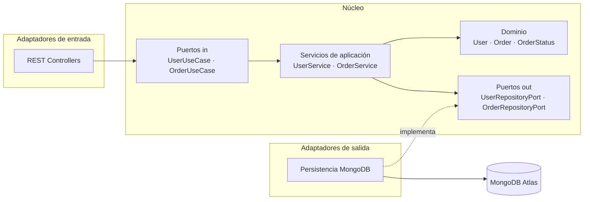
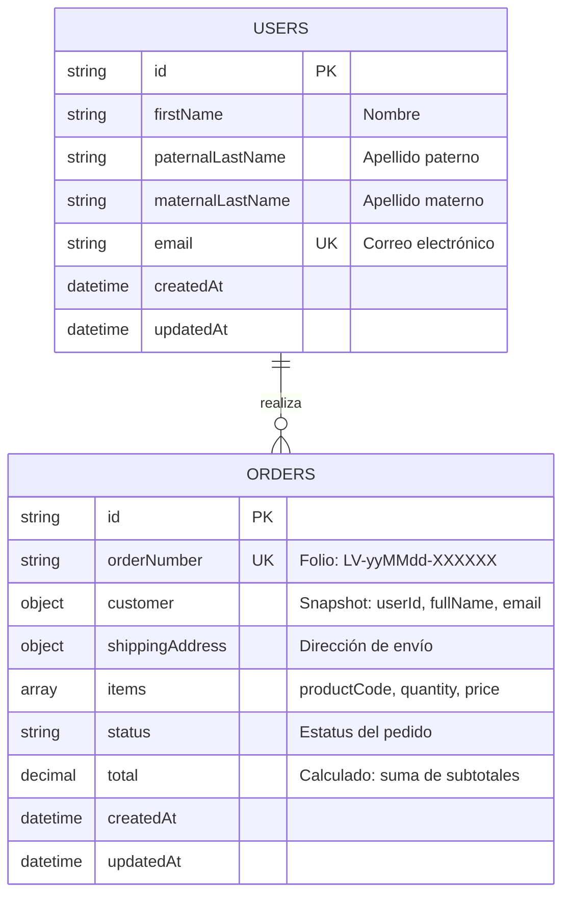
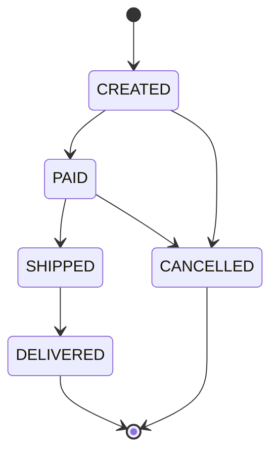
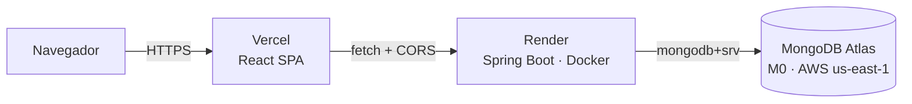

# Liverpool Orders — Sistema de gestión de pedidos

Sistema para que el equipo de ventas gestione los pedidos realizados desde la **aplicación móvil** y el **sitio web**. Expone una API REST para el CRUD de pedidos y usuarios, y una interfaz web para consultar, filtrar y ver el detalle de cada pedido.

> **Estado:** en desarrollo — ver [Roadmap](#roadmap).

### Demo en línea

---

## Tabla de contenido

- [Stack](#stack)
- [Arquitectura](#arquitectura)
- [Estructura del proyecto](#estructura-del-proyecto)
- [Modelo de datos](#modelo-de-datos)
- [Reglas de negocio](#reglas-de-negocio)
- [Requisitos previos](#requisitos-previos)
- [Configuración](#configuración)
- [Ejecución local](#ejecución-local)
- [Datos de prueba](#datos-de-prueba)
- [Frontend](#frontend)
- [API](#api)
- [Pruebas](#pruebas)
- [Despliegue](#despliegue)
- [Decisiones técnicas](#decisiones-técnicas)
- [Roadmap](#roadmap)

---

## Stack

| Capa | Tecnología |
|---|---|
| Backend | Java 21, Spring Boot 4, Spring Web MVC, Spring Data MongoDB, Bean Validation |
| Base de datos | MongoDB 8 (MongoDB Atlas) · MongoDB 7 vía Docker para desarrollo local |
| Documentación API | springdoc-openapi (OpenAPI 3 + Swagger UI) |
| Observabilidad | Spring Boot Actuator (`/actuator/health`) |
| Build | Maven Wrapper |
| Frontend | React 19, TypeScript, Vite, React Router, CSS Modules |

---

## Arquitectura

El backend sigue **arquitectura hexagonal (Ports & Adapters)**. Las dependencias apuntan siempre hacia el dominio: el núcleo de negocio no conoce Spring, MongoDB ni HTTP.



| Capa | Paquete | Responsabilidad | Depende de |
|---|---|---|---|
| Dominio | `domain.model`, `domain.exception` | Entidades, reglas de negocio, máquina de estados | Nada (Java puro) |
| Puertos | `domain.port.in`, `domain.port.out` | Contratos de casos de uso y de persistencia | Dominio |
| Aplicación | `application.service` | Orquesta casos de uso | Dominio + puertos |
| Infraestructura | `infrastructure.*` | REST, MongoDB, configuración de Spring | Todo lo anterior |

Los servicios de aplicación **no llevan anotaciones de Spring**; se registran como beans en `infrastructure.config`. Esto permite probarlos con mocks simples y cambiar de framework o base de datos sin tocar la lógica de negocio.

---

## Estructura del proyecto

```
liverpool-orders/
├── backend/
│   └── src/main/java/com/liverpool/orders/
│       ├── domain/
│       │   ├── model/          # User, Order, OrderItem, Address, Customer, OrderStatus
│       │   ├── exception/      # BusinessRuleException, NotFoundException, ConflictException
│       │   └── port/
│       │       ├── in/         # Casos de uso + commands
│       │       └── out/        # Puertos de persistencia
│       ├── application/
│       │   └── service/        # UserService, OrderService
│       └── infrastructure/
│           ├── adapter/
│           │   ├── in/web/     # Controllers, DTOs, mappers
│           │   └── out/persistence/  # Adaptadores, documentos, mappers y repositorios MongoDB
│           └── config/         # Wiring de beans, OpenAPI
├── frontend/
│   └── src/
│       ├── api/                # Cliente HTTP y endpoints
│       ├── components/         # Componentes reutilizables (Typeahead, DataTable, StatusBadge…)
│       ├── hooks/              # useAsync, useDebounce, useOrders
│       ├── pages/              # OrdersPage, OrderDetailPage
│       ├── styles/             # Tokens de diseño y estilos globales
│       ├── types/              # Contratos de la API
│       └── utils/              # Formatos y reglas de estatus
├── docker-compose.yml          # MongoDB local
├── render.yaml                 # Infraestructura como código del backend (Render Blueprint)
└── README.md
```

---

## Modelo de datos

Dos colecciones: `users` y `orders`.



### Mapeo con el requerimiento

| Requerimiento | Campo |
|---|---|
| Nombre, apellido paterno, apellido materno, correo | `users.firstName`, `paternalLastName`, `maternalLastName`, `email` |
| Dirección de envío | `orders.shippingAddress` (calle, colonia, ciudad, estado, CP) |
| Código del producto, cantidad, precio | `orders.items[]` (`productCode`, `quantity`, `price`) |
| Estatus de pedido | `orders.status` |

### Snapshot del cliente en el pedido

Cada pedido embebe una copia de los datos del cliente (`userId`, nombre completo y email) al momento de crearse:

- **Lectura sin joins:** la lista, el detalle y la búsqueda se resuelven con una sola consulta a `orders`.
- **Valor histórico:** si el usuario cambia su email, los pedidos existentes conservan los datos con los que se realizó la compra, igual que un ticket.

### Índices

Se declaran con anotaciones en los documentos (`@Indexed`, `@CompoundIndex`) y se crean de forma explícita e idempotente al arrancar la aplicación (`MongoIndexInitializer`).

| Colección | Campo(s) | Tipo | Propósito |
|---|---|---|---|
| `users` | `email` | Único | Garantiza email único incluso ante peticiones concurrentes |
| `orders` | `orderNumber` | Único | Folio irrepetible |
| `orders` | `customer.userId` | Simple | Validar si un usuario tiene pedidos antes de eliminarlo |
| `orders` | `status` | Simple | Filtro por estatus |
| `orders` | `createdAt` | Simple | Orden por fecha (más recientes primero) |

### Búsqueda de pedidos

Un solo término busca, sin distinguir mayúsculas, en:

- Folio (`orderNumber`)
- Nombre del cliente (`customer.fullName`)
- Email del cliente (`customer.email`)
- Código de producto (`items.productCode`)

Opcionalmente se combina con un filtro por estatus. Los resultados se paginan y ordenan por fecha de creación descendente. El término se escapa antes de construir la expresión regular, así que caracteres como `.` o `+` se buscan literalmente.

---

## Reglas de negocio

### Ciclo de vida del pedido



| Regla | Resultado si se viola |
|---|---|
| Un pedido debe tener al menos un producto | `422` |
| Cantidad > 0 y precio ≥ 0 | `422` |
| Solo se permiten las transiciones de estatus del diagrama | `422` |
| El contenido de un pedido solo se edita en estatus `CREATED` | `422` |
| El usuario de un pedido debe existir | `422` |
| El email de un usuario es único (se normaliza a minúsculas) | `409` |
| No se elimina un usuario que tiene pedidos | `409` |
| Recurso inexistente | `404` |

Las reglas viven en el dominio (`Order`, `OrderItem`, `OrderStatus`), no en los controllers.

---

## Requisitos previos

- **Java 21** (probado con Eclipse Temurin 21.0.12)
- **Node.js 20+**
- **Git**
- Una de estas dos opciones para la base de datos:
  - Cuenta en **MongoDB Atlas** (tier gratuito M0), o
  - **Docker** para MongoDB local

---

## Configuración

La aplicación lee la conexión de la variable de entorno `MONGODB_URI`. Si no está definida, usa `mongodb://localhost:27017/liverpool_orders`.

| Variable | Default | Descripción |
|---|---|---|
| `MONGODB_URI` | `mongodb://localhost:27017/liverpool_orders` | Cadena de conexión a MongoDB |
| `PORT` | `8080` | Puerto HTTP del backend |
| `CORS_ALLOWED_ORIGINS` | `http://localhost:5173` | Orígenes permitidos para el frontend (separados por coma) |
| `SEED_ENABLED` | `true` | Carga datos de prueba al arrancar si la base está vacía |

**Opción A — MongoDB Atlas**

```bash
export MONGODB_URI='mongodb+srv://<usuario>:<password>@<cluster>.mongodb.net/liverpool_orders?retryWrites=true&w=majority'
```

**Opción B — MongoDB local con Docker**

```bash
docker compose up -d
# no es necesario definir MONGODB_URI
```

> Las credenciales nunca se versionan: se inyectan por variable de entorno.

---

## Ejecución local

```bash
git clone https://github.com/brawn7/liverpool-orders.git
cd liverpool-orders/backend
./mvnw spring-boot:run          # Windows CMD/PowerShell: mvnw.cmd spring-boot:run
```

Verificación:

```bash
curl http://localhost:8080/actuator/health
# {"groups":["liveness","readiness"],"status":"UP"}
```

### Aplicación web

En otra terminal:

```bash
cd liverpool-orders/frontend
cp .env.example .env            # VITE_API_URL=http://localhost:8080
npm install
npm run dev                     # http://localhost:5173
```

| Recurso | URL |
|---|---|
| Aplicación web | http://localhost:5173 |
| Health check | http://localhost:8080/actuator/health |
| Swagger UI | http://localhost:8080/swagger-ui.html |
| OpenAPI JSON | http://localhost:8080/v3/api-docs |

---

## Datos de prueba

Al arrancar, si la colección `users` está vacía, la aplicación carga automáticamente:

- **8 usuarios** con nombre, apellidos, email y dirección de envío.
- **30 pedidos** con 1 a 3 productos cada uno, distribuidos en todos los estatus (`CREATED`, `PAID`, `SHIPPED`, `DELIVERED`, `CANCELLED`).

Los datos se generan **a través de los casos de uso**, no con inserciones directas: cada usuario y pedido pasa por las mismas validaciones y transiciones de estatus que una petición real. La generación usa una semilla fija, así que el resultado es reproducible.

```
Seed completado: 8 usuarios, 30 pedidos
```

Para recargar los datos desde cero, elimina la base `liverpool_orders` (en Atlas: *Data Explorer → Drop database*; en Docker: `docker compose down -v`) y reinicia la aplicación. Para desactivar la carga: `SEED_ENABLED=false`.

---

## Frontend

Dos pantallas, con los filtros reflejados en la URL (`/?q=maria&status=PAID&page=1`) para que se puedan compartir y el botón *atrás* los conserve.

### Lista de pedidos (`/`)

- **Búsqueda con typeahead:** mientras se escribe (a partir de 2 caracteres, con *debounce* de 300 ms) se muestran sugerencias con folio, cliente, email, estatus y total, resaltando la coincidencia.
  - Seleccionar una sugerencia filtra la lista por ese pedido; `Enter` sin seleccionar filtra por el texto escrito.
  - Si no hay coincidencias se muestra *"No se encontraron pedidos que coincidan con «…»"*.
  - Navegación con teclado (`↑` `↓` `Enter` `Esc`) y roles ARIA de *combobox*.
  - Cada petición nueva cancela la anterior (`AbortController`), así una respuesta lenta nunca sobrescribe una más reciente.
- **Filtro por estatus** con chips.
- **Paginación** del lado del servidor.
- Estados de carga (*skeleton*), vacío y error con reintento.

### Detalle del pedido (`/orders/:id`)

- Datos del cliente, dirección de envío, resumen y productos con subtotales y total.
- Línea de tiempo del estatus.
- Acciones para avanzar el estatus según la máquina de estados (*Marcar como pagado*, *Enviar*, *Entregar*, *Cancelar*). El servidor valida la transición y cualquier error se muestra en pantalla.

### Reutilización de componentes

| Pieza | Tipo | Dónde se usa |
|---|---|---|
| `Typeahead<T>` | Componente genérico | Agnóstico del dominio; `OrderSearch` lo especializa para pedidos |
| `DataTable<T>` | Componente genérico | Lista de pedidos y productos del detalle |
| `StatusBadge` | Componente | Tabla, sugerencias y detalle |
| `Card`, `EmptyState`, `ErrorState`, `LoadingRows`, `Pagination`, `StatusFilter`, `Highlight` | Componentes | Ambas pantallas |
| `useAsync` | Hook | Base de todas las peticiones: estado, cancelación y recarga |
| `useDebounce` | Hook | Typeahead |
| `useOrderSearch`, `useOrder`, `useOrderSuggestions` | Hooks | Encapsulan el acceso a datos de cada pantalla |
| `api/client.ts` | Módulo | Único punto HTTP; traduce errores RFC 9457 a `ApiError` |

### Responsive

Diseño *mobile-first* probado en 390 px y 1280 px. Debajo de 720 px las tablas se convierten en tarjetas (cada celda muestra su encabezado), las tarjetas del detalle pasan a una columna y los filtros se desplazan horizontalmente.

---

## API

Documentación interactiva completa en **Swagger UI** (`/swagger-ui.html`). Base path: `/api`.

### Usuarios

| Método | Ruta | Descripción | Éxito |
|---|---|---|---|
| `POST` | `/api/users` | Crear usuario | `201` + `Location` |
| `GET` | `/api/users?page=0&size=20` | Listar usuarios (paginado) | `200` |
| `GET` | `/api/users/{id}` | Obtener usuario | `200` |
| `PUT` | `/api/users/{id}` | Actualizar usuario | `200` |
| `DELETE` | `/api/users/{id}` | Eliminar usuario (sin pedidos) | `204` |

### Pedidos

| Método | Ruta | Descripción | Éxito |
|---|---|---|---|
| `POST` | `/api/orders` | Crear pedido | `201` + `Location` |
| `GET` | `/api/orders?q=&status=&page=0&size=20` | Buscar / listar pedidos (paginado) | `200` |
| `GET` | `/api/orders/suggestions?q=&limit=8` | Sugerencias para el typeahead | `200` |
| `GET` | `/api/orders/{id}` | Detalle del pedido | `200` |
| `PUT` | `/api/orders/{id}` | Actualizar cliente, dirección e items (solo `CREATED`) | `200` |
| `PATCH` | `/api/orders/{id}/status` | Cambiar estatus | `200` |
| `DELETE` | `/api/orders/{id}` | Eliminar pedido | `204` |

### Ejemplo: crear un pedido

```bash
curl -X POST http://localhost:8080/api/orders \
  -H "Content-Type: application/json" \
  -d '{
    "userId": "<id-del-usuario>",
    "shippingAddress": {
      "street": "Av. Insurgentes Sur 1234",
      "neighborhood": "Del Valle",
      "city": "Ciudad de Mexico",
      "state": "CDMX",
      "zipCode": "03100"
    },
    "items": [
      { "productCode": "1098765432", "quantity": 2, "price": 1299.00 },
      { "productCode": "1012345678", "quantity": 1, "price": 349.50 }
    ]
  }'
```

### Formato de errores

Todas las respuestas de error siguen **RFC 9457 (Problem Details)**:

```json
{
  "type": "about:blank",
  "title": "Datos inválidos",
  "status": 400,
  "detail": "La solicitud contiene errores de validación",
  "instance": "/api/orders",
  "timestamp": "2026-10-19T22:10:00Z",
  "errors": {
    "items": "El pedido debe tener al menos un producto",
    "shippingAddress.zipCode": "El código postal debe tener 5 dígitos"
  }
}
```

| Código | Cuándo |
|---|---|
| `400` | Validación de entrada, JSON mal formado, parámetro inválido |
| `404` | Recurso inexistente |
| `409` | Email duplicado, usuario con pedidos |
| `422` | Regla de negocio violada (transición de estatus inválida, edición fuera de `CREATED`, usuario inexistente) |
| `500` | Error inesperado (se registra en log; no se exponen detalles internos) |

---

## Pruebas

```bash
cd backend
./mvnw test
```

Pruebas unitarias del núcleo, sin levantar Spring ni requerir base de datos:

| Suite | Qué valida |
|---|---|
| `OrderStatusTest` | Todas las transiciones de la máquina de estados (permitidas y prohibidas) |
| `OrderTest` | Estatus inicial, cálculo del total, pedido sin productos, edición bloqueada después del pago, validación de items |
| `UserServiceTest` | Email duplicado (con normalización), actualización conservando el propio email, bloqueo de borrado con pedidos, 404 |
| `OrderServiceTest` | Snapshot del cliente y formato del folio al crear, usuario inexistente, persistencia de cambios de estatus |

Los servicios se prueban con mocks de los puertos de salida; esto es posible porque la capa de aplicación no depende de Spring ni de MongoDB.

---

## Despliegue



| Componente | Plataforma | Configuración |
|---|---|---|
| Frontend | Vercel | Directorio raíz `frontend/`; `vercel.json` reescribe las rutas a `index.html` para que los links directos (`/orders/:id`) funcionen |
| Backend | Render (Docker) | Definido en `render.yaml`; imagen multi-stage en `backend/Dockerfile`; health check en `/actuator/health` |
| Base de datos | MongoDB Atlas | Cluster M0 en `us-east-1`, la misma región que el backend |

### Variables de entorno

| Plataforma | Variable | Valor |
|---|---|---|
| Render | `MONGODB_URI` | Cadena de conexión de Atlas |
| Render | `CORS_ALLOWED_ORIGINS` | URL del frontend en Vercel (sin `/` final) |
| Render | `SEED_ENABLED` | `true` (solo carga datos si la base está vacía) |
| Vercel | `VITE_API_URL` | URL del backend en Render (sin `/` final) |

`VITE_API_URL` se incrusta en tiempo de build: si cambia, hay que volver a desplegar el frontend.

### Imagen Docker

- **Multi-stage:** compila con el JDK y ejecuta solo con el JRE, así la imagen final no incluye Maven ni el código fuente.
- **Capa de dependencias cacheada:** se copian `pom.xml` y el wrapper antes que el código, así un cambio en `src/` no vuelve a descargar dependencias.
- **Usuario sin privilegios** (`uid 1001`).
- **JVM ajustada a 512 MB y 0.1 CPU:** heap proporcional al contenedor, GC serial y compilación JIT de un nivel para arrancar más rápido.

---

## Decisiones técnicas

| Decisión | Motivo |
|---|---|
| **Java 21 + Spring Boot 4** | Requerimiento de Java como backend; records y `switch` expresivo para un dominio conciso. |
| **Arquitectura hexagonal** | Aísla las reglas de negocio de la infraestructura y facilita las pruebas unitarias. |
| **Servicios sin anotaciones de Spring** | La capa de aplicación no depende del framework; el wiring vive en infraestructura. |
| **Máquina de estados en el enum** | Las transiciones válidas están en un solo lugar y se prueban de forma aislada. |
| **Snapshot del cliente en el pedido** | Lecturas en una sola consulta y conservación del dato histórico. |
| **Items como lista** | Cubre el caso de un producto por pedido y soporta pedidos con varios productos. |
| **`BigDecimal` para precios** | Evita errores de redondeo de punto flotante en montos. |
| **Folio legible `LV-yyMMdd-XXXXXX`** | Fácil de dictar y buscar; excluye caracteres ambiguos (0/O, 1/I). |
| **Usuario inexistente al crear pedido → 422** | El recurso solicitado es el pedido; el usuario inválido es un error de datos de entrada, no un 404. |
| **Configuración por variables de entorno** | El mismo artefacto corre en local y en la nube sin cambios de código. |
| **Creación explícita de índices al arrancar** | Spring Data desaconseja `auto-index-creation` (deshabilitado por defecto); crearlos de forma explícita hace el comportamiento predecible y visible en el log. |
| **Documentos de persistencia separados del dominio** | El esquema de MongoDB puede evolucionar sin contaminar el modelo de negocio; los mappers hacen la traducción. |
| **Precios y total como `Decimal128`** | Spring Data guarda `BigDecimal` como texto por defecto; `Decimal128` conserva precisión y permite ordenar y agregar numéricamente. |
| **Total persistido además de calculado** | El dominio lo calcula; se guarda para ordenar o reportar sin recalcular en cada consulta. |
| **Búsqueda con regex sobre campos acotados** | Suficiente para el volumen del ejercicio. En producción la evolución natural es Atlas Search con índice `autocomplete`. |
| **Estatus como `String` en el documento** | El documento no depende del enum de dominio; la conversión ocurre en el mapper. |
| **DTOs de entrada/salida separados del dominio** | El contrato HTTP es independiente del modelo interno; la validación de formato vive en el borde (Bean Validation) y la de negocio en el dominio. |
| **Problem Details (RFC 9457)** | Formato de error estándar y homogéneo, soportado nativamente por Spring. |
| **`PATCH /status` separado de `PUT`** | El cambio de estatus es una operación con reglas propias (máquina de estados), distinta de editar el contenido del pedido. |
| **Endpoint de sugerencias dedicado** | El typeahead necesita una respuesta ligera y limitada; la lista completa usa el endpoint paginado. |
| **`201 Created` + header `Location`** | Semántica REST estándar al crear recursos. |
| **CORS por variable de entorno** | El origen del frontend cambia entre local y producción sin recompilar. |
| **Seed vía casos de uso** | Los datos de prueba respetan las mismas reglas que la API; si una regla cambia, el seed lo detecta. |
| **Seed idempotente con semilla fija** | Solo corre con la base vacía y siempre genera los mismos datos, útil para demos reproducibles. |
| **React + Vite sin framework de UI** | Dos pantallas no justifican Next.js; CSS Modules con tokens mantiene el bundle chico y el estilo bajo control. |
| **Filtros en la URL** | Estado compartible, recargable y compatible con el historial del navegador. |
| **Componentes genéricos (`Typeahead<T>`, `DataTable<T>`)** | La lógica de interacción se escribe una vez y se especializa por dominio. |
| **Cancelación de peticiones** | Evita condiciones de carrera en el typeahead y al cambiar filtros rápido. |
| **Reglas de estatus duplicadas en el front solo para la UI** | Deciden qué botones mostrar; la validación real sigue en el backend. |
| **Render + Vercel + Atlas en planes gratuitos** | Demo pública sin costo; backend y base en la misma región de AWS para minimizar latencia. |
| **`render.yaml` (Blueprint)** | La infraestructura del backend queda versionada y reproducible en lugar de configurada a mano. |
| **Aviso de arranque en frío en la UI** | El plan gratuito apaga la API por inactividad; el usuario sabe que debe esperar en vez de pensar que la app falló. |
| **Pruebas unitarias sin base de datos** | Rápidas y deterministas. La evolución natural son pruebas de integración con Testcontainers (requiere Docker). |

---

## Roadmap

- [x] Scaffold del backend y conexión a MongoDB Atlas
- [x] Modelo de dominio y máquina de estados del pedido
- [x] Puertos y casos de uso
- [x] Adaptadores de persistencia MongoDB e índices
- [x] API REST, manejo de errores y documentación OpenAPI
- [x] Datos de prueba (seed) y pruebas unitarias
- [x] Frontend: lista de pedidos con typeahead y detalle
- [x] Diseño responsive
- [ ] Despliegue en la nube
- [ ] Video y capturas de la demo