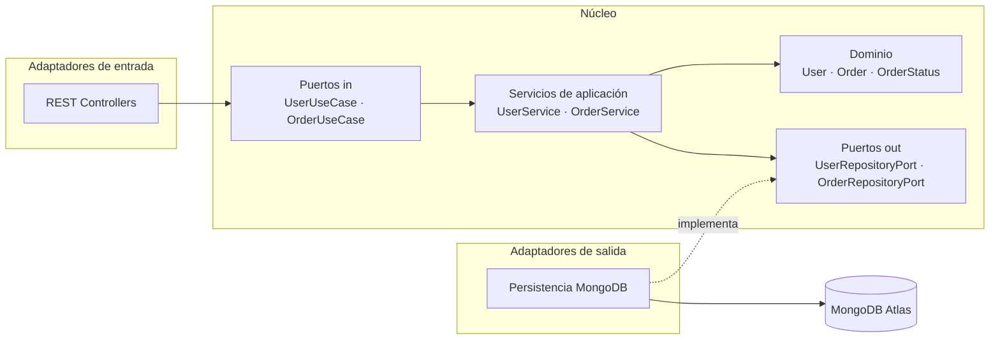
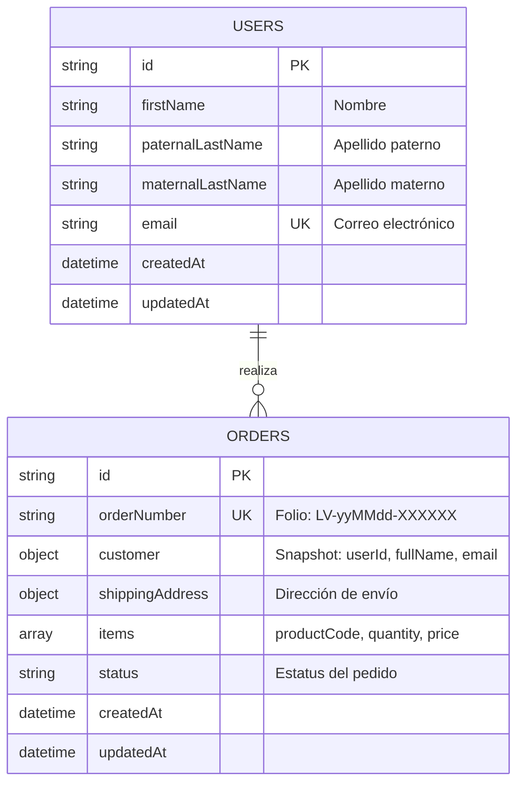
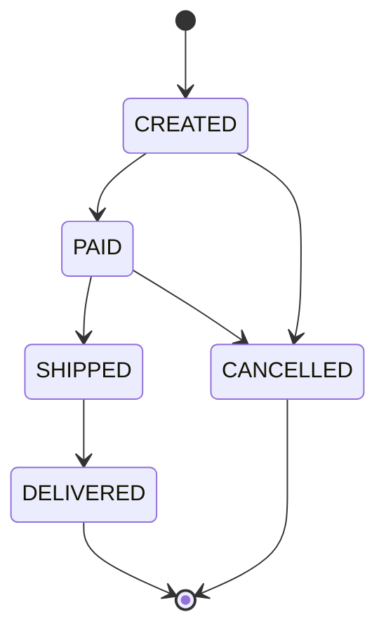

# Liverpool Orders — Sistema de gestión de pedidos

Sistema para que el equipo de ventas gestione los pedidos realizados desde la **aplicación móvil** y el **sitio web**. Expone una API REST para el CRUD de pedidos y usuarios, y una interfaz web para consultar, filtrar y ver el detalle de cada pedido.

> **Estado:** en desarrollo — ver [Roadmap](#roadmap).

---

## Tabla de contenido

- [Stack](#stack)
- [Arquitectura](#arquitectura)
- [Estructura del proyecto](#estructura-del-proyecto)
- [Modelo de datos](#modelo-de-datos)
- [Reglas de negocio](#reglas-de-negocio)
- [Requisitos previos](#requisitos-previos)
- [Configuración](#configuración)
- [Ejecución local](#ejecución-local)
- [Decisiones técnicas](#decisiones-técnicas)
- [Roadmap](#roadmap)

---

## Stack

| Capa | Tecnología |
|---|---|
| Backend | Java 21, Spring Boot 4, Spring Web MVC, Spring Data MongoDB, Bean Validation |
| Base de datos | MongoDB 8 (MongoDB Atlas) · MongoDB 7 vía Docker para desarrollo local |
| Documentación API | springdoc-openapi (OpenAPI 3 + Swagger UI) |
| Observabilidad | Spring Boot Actuator (`/actuator/health`) |
| Build | Maven Wrapper |
| Frontend | React + Vite + TypeScript *(en desarrollo)* |

---

## Arquitectura

El backend sigue **arquitectura hexagonal (Ports & Adapters)**. Las dependencias apuntan siempre hacia el dominio: el núcleo de negocio no conoce Spring, MongoDB ni HTTP.



| Capa | Paquete | Responsabilidad | Depende de |
|---|---|---|---|
| Dominio | `domain.model`, `domain.exception` | Entidades, reglas de negocio, máquina de estados | Nada (Java puro) |
| Puertos | `domain.port.in`, `domain.port.out` | Contratos de casos de uso y de persistencia | Dominio |
| Aplicación | `application.service` | Orquesta casos de uso | Dominio + puertos |
| Infraestructura | `infrastructure.*` | REST, MongoDB, configuración de Spring | Todo lo anterior |

Los servicios de aplicación **no llevan anotaciones de Spring**; se registran como beans en `infrastructure.config`. Esto permite probarlos con mocks simples y cambiar de framework o base de datos sin tocar la lógica de negocio.

---

## Estructura del proyecto

```
liverpool-orders/
├── backend/
│   └── src/main/java/com/liverpool/orders/
│       ├── domain/
│       │   ├── model/          # User, Order, OrderItem, Address, Customer, OrderStatus
│       │   ├── exception/      # BusinessRuleException, NotFoundException, ConflictException
│       │   └── port/
│       │       ├── in/         # Casos de uso + commands
│       │       └── out/        # Puertos de persistencia
│       ├── application/
│       │   └── service/        # UserService, OrderService
│       └── infrastructure/
│           ├── adapter/
│           │   ├── in/web/     # Controllers, DTOs, mappers
│           │   └── out/persistence/  # Documentos y repositorios MongoDB
│           └── config/         # Wiring de beans, OpenAPI
├── frontend/                   # React + Vite (en desarrollo)
├── docker-compose.yml          # MongoDB local
└── README.md
```

---

## Modelo de datos

Dos colecciones: `users` y `orders`.



### Mapeo con el requerimiento

| Requerimiento | Campo |
|---|---|
| Nombre, apellido paterno, apellido materno, correo | `users.firstName`, `paternalLastName`, `maternalLastName`, `email` |
| Dirección de envío | `orders.shippingAddress` (calle, colonia, ciudad, estado, CP) |
| Código del producto, cantidad, precio | `orders.items[]` (`productCode`, `quantity`, `price`) |
| Estatus de pedido | `orders.status` |

### Snapshot del cliente en el pedido

Cada pedido embebe una copia de los datos del cliente (`userId`, nombre completo y email) al momento de crearse:

- **Lectura sin joins:** la lista, el detalle y la búsqueda se resuelven con una sola consulta a `orders`.
- **Valor histórico:** si el usuario cambia su email, los pedidos existentes conservan los datos con los que se realizó la compra, igual que un ticket.

---

## Reglas de negocio

### Ciclo de vida del pedido



| Regla | Resultado si se viola |
|---|---|
| Un pedido debe tener al menos un producto | `422` |
| Cantidad > 0 y precio ≥ 0 | `422` |
| Solo se permiten las transiciones de estatus del diagrama | `422` |
| El contenido de un pedido solo se edita en estatus `CREATED` | `422` |
| El usuario de un pedido debe existir | `422` |
| El email de un usuario es único (se normaliza a minúsculas) | `409` |
| No se elimina un usuario que tiene pedidos | `409` |
| Recurso inexistente | `404` |

Las reglas viven en el dominio (`Order`, `OrderItem`, `OrderStatus`), no en los controllers.

---

## Requisitos previos

- **Java 21** (probado con Eclipse Temurin 21.0.12)
- **Node.js 20+**
- **Git**
- Una de estas dos opciones para la base de datos:
  - Cuenta en **MongoDB Atlas** (tier gratuito M0), o
  - **Docker** para MongoDB local

---

## Configuración

La aplicación lee la conexión de la variable de entorno `MONGODB_URI`. Si no está definida, usa `mongodb://localhost:27017/liverpool_orders`.

| Variable | Default | Descripción |
|---|---|---|
| `MONGODB_URI` | `mongodb://localhost:27017/liverpool_orders` | Cadena de conexión a MongoDB |
| `PORT` | `8080` | Puerto HTTP del backend |

**Opción A — MongoDB Atlas**

```bash
export MONGODB_URI='mongodb+srv://<usuario>:<password>@<cluster>.mongodb.net/liverpool_orders?retryWrites=true&w=majority'
```

**Opción B — MongoDB local con Docker**

```bash
docker compose up -d
# no es necesario definir MONGODB_URI
```

> Las credenciales nunca se versionan: se inyectan por variable de entorno.

---

## Ejecución local

```bash
git clone https://github.com/brawn7/liverpool-orders.git
cd liverpool-orders/backend
./mvnw spring-boot:run          # Windows CMD/PowerShell: mvnw.cmd spring-boot:run
```

Verificación:

```bash
curl http://localhost:8080/actuator/health
# {"groups":["liveness","readiness"],"status":"UP"}
```

| Recurso | URL |
|---|---|
| Health check | http://localhost:8080/actuator/health |
| Swagger UI | http://localhost:8080/swagger-ui.html |
| OpenAPI JSON | http://localhost:8080/v3/api-docs |

---

## Decisiones técnicas

| Decisión | Motivo |
|---|---|
| **Java 21 + Spring Boot 4** | Requerimiento de Java como backend; records y `switch` expresivo para un dominio conciso. |
| **Arquitectura hexagonal** | Aísla las reglas de negocio de la infraestructura y facilita las pruebas unitarias. |
| **Servicios sin anotaciones de Spring** | La capa de aplicación no depende del framework; el wiring vive en infraestructura. |
| **Máquina de estados en el enum** | Las transiciones válidas están en un solo lugar y se prueban de forma aislada. |
| **Snapshot del cliente en el pedido** | Lecturas en una sola consulta y conservación del dato histórico. |
| **Items como lista** | Cubre el caso de un producto por pedido y soporta pedidos con varios productos. |
| **`BigDecimal` para precios** | Evita errores de redondeo de punto flotante en montos. |
| **Folio legible `LV-yyMMdd-XXXXXX`** | Fácil de dictar y buscar; excluye caracteres ambiguos (0/O, 1/I). |
| **Usuario inexistente al crear pedido → 422** | El recurso solicitado es el pedido; el usuario inválido es un error de datos de entrada, no un 404. |
| **Configuración por variables de entorno** | El mismo artefacto corre en local y en la nube sin cambios de código. |

---

## Roadmap

- [x] Scaffold del backend y conexión a MongoDB Atlas
- [x] Modelo de dominio y máquina de estados del pedido
- [x] Puertos y casos de uso
- [ ] Adaptadores de persistencia MongoDB e índices
- [ ] API REST, manejo de errores y documentación OpenAPI
- [ ] Datos de prueba (seed) y pruebas unitarias
- [ ] Frontend: lista de pedidos con typeahead y detalle
- [ ] Diseño responsive
- [ ] Despliegue en la nube
- [ ] Video y capturas de la demo